# Консоль администрирования RAS

Консоль администрирования кластеров серверов **1С:Предприятия 8** для Windows и Linux. Она подключается сразу к нескольким серверам администрирования (`ras`) разных версий и умеет всё, что стандартная консоль кластера. Сверху — то, чего в стандартной консоли нет: сводка по всем серверам, оповещения, регламентные работы по расписанию, отчёты, групповые операции и диагностика сети.

Написана на Java (JavaFX) и работает через официальную библиотеку 1С для сервера администрирования. COM-коннектор и `rac` для основной работы не нужны.

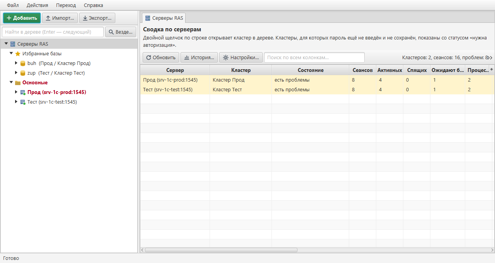

## Возможности

### Всё из стандартной консоли кластера

- Несколько серверов RAS в одном дереве: группы («Прод», «Тест»), пометка продуктивных серверов, импорт и экспорт списка.
- Кластеры, администраторы, менеджеры и сервисы, рабочие серверы и процессы, требования назначения функциональности.
- Информационные базы:
  - создание с базой данных на СУБД;
  - свойства;
  - блокировка сеансов и регламентных заданий;
  - удаление вместе с БД или без неё.
- Сеансы, соединения и блокировки — по кластеру, базе и рабочему процессу. Завершение сеансов с сообщением, прерывание серверного вызова.
- Профили безопасности со всеми видами разрешений, счётчики и ограничения потребления ресурсов.
- Перезапуск рабочих процессов (`rphost`) средствами кластера — как «Выключить» в стандартной консоли.
- Серверы RAS версий 8.3 и 8.5 одновременно (проверено на 8.3.27 и 8.5.4).

### Сверх стандартной консоли

**Наблюдение и оповещения**
- Сводка по всем серверам и кластерам: сеансы, лицензии, память `rphost`, ожидания на блокировках, долгие вызовы.
- Пороги проблем:
  - память процесса;
  - «Время вызова (текущее)»;
  - «Захвачено СУБД (текущее)»;
  - ожидание блокировки;
  - число сеансов и лицензий.
- Оповещения в трей, в **Telegram**, на **почту** (SMTP) и на **webhook** (Slack, Mattermost, Rocket.Chat). Отдельное сообщение — «связь с сервером восстановлена».
- История показателей с графиками.

**Анализ сеансов**
- **Тяжёлые сеансы** — сверху те, кто сильнее всего грузит сервер.
- **Сеансы по группам** — по пользователю, компьютеру, приложению или базе. Сразу видно, кто занял несколько лицензий.
- **Дерево ожиданий на блокировках**: кто кого держит.
- Раздел **«Лицензии»**: какие лицензии кем заняты.

**Регламентные работы**
- Блокировка нескольких баз с завершением сеансов. Исключения — например, не трогать Конфигуратор.
- **По расписанию**: в 22:00 заблокировать и выгнать пользователей, в 23:30 снять блокировку.

**Работа с базами**
- **Избранные базы** с разных серверов.
- **Журнал входов и выходов** в наблюдаемые базы.
- **Групповое изменение параметров** нескольких баз.
- Запуск 1С и Конфигуратора нужной версии, строка подключения, файл списка баз `.v8i`.

**Удобство**
- **Вкладки**.
- **Закладки** Ctrl+1…9 и **недавние узлы** Ctrl+E.
- **Отбор по значению** из контекстного меню любой таблицы.
- Поиск по всем серверам.
- **Тёмная тема**.
- Цветные кнопки ключевых команд.

**Отчёты и интеграция**
- **Отчёт по серверам** в Excel (`.xlsx`) или HTML.
- Экспорт любой таблицы в CSV.

**Диагностика и безопасность**
- **Диагностика сети** по шагам: DNS, ping, порт RAS, ответ RAS и его связь с агентом, порты кластера. Отличает «порт закрыт» от «нет ответа (файрвол)».
- **Журнал действий администратора**.
- Подтверждение опасных действий на продуктивных серверах.

**Командная строка `RasCli`** — для Планировщика Windows и cron: блокировка и снятие блокировки баз, завершение сеансов, перезапуск процессов, отчёт.

### Скриншоты

| | |
|---|---|
| 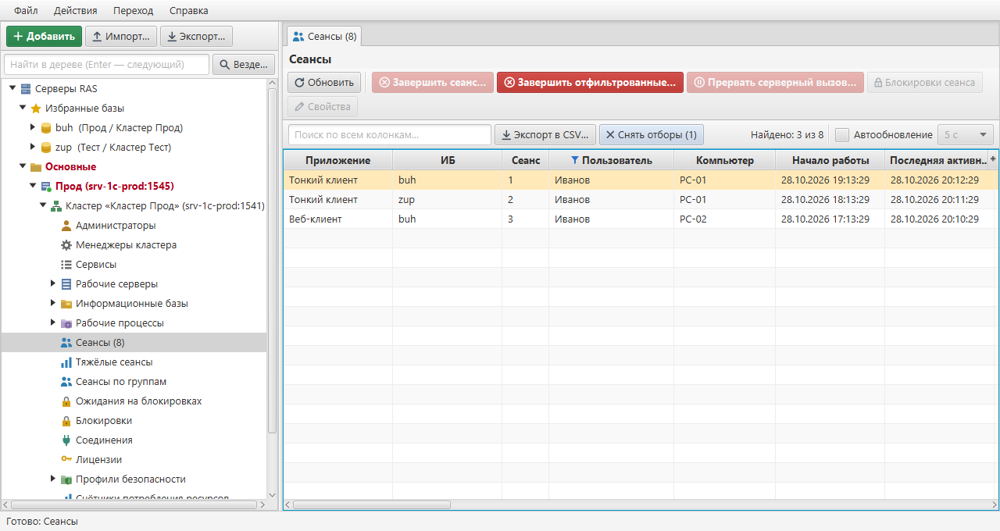 **Сеансы с отбором по пользователю** (правый щелчок по ячейке → «Отбор») | 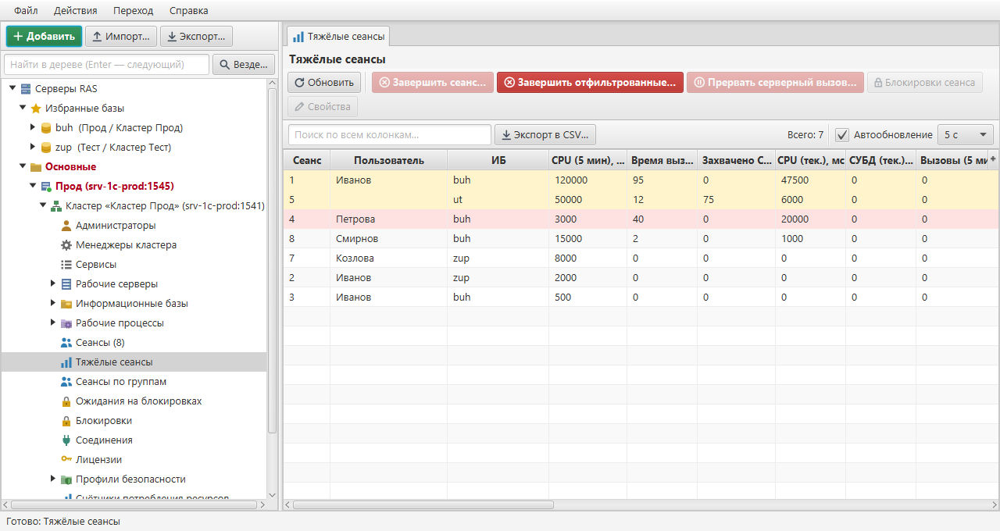 **Тяжёлые сеансы**: долгие вызовы и ожидание блокировки подсвечены |
| 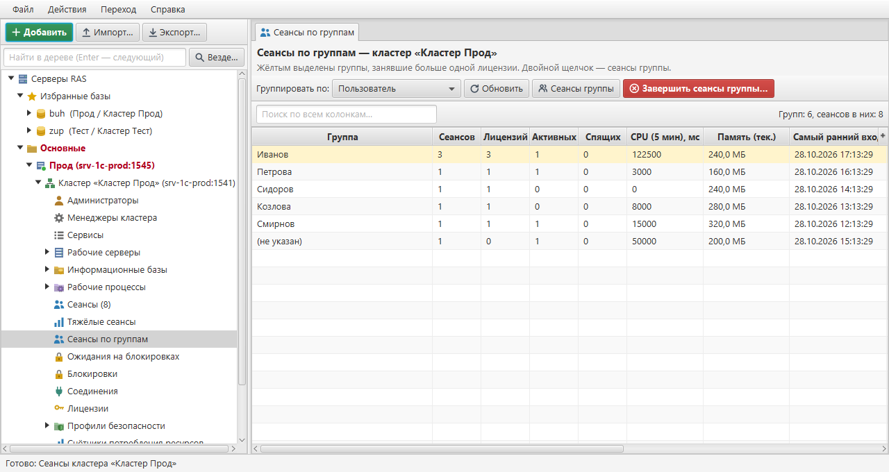 **Сеансы по группам** и вкладки | 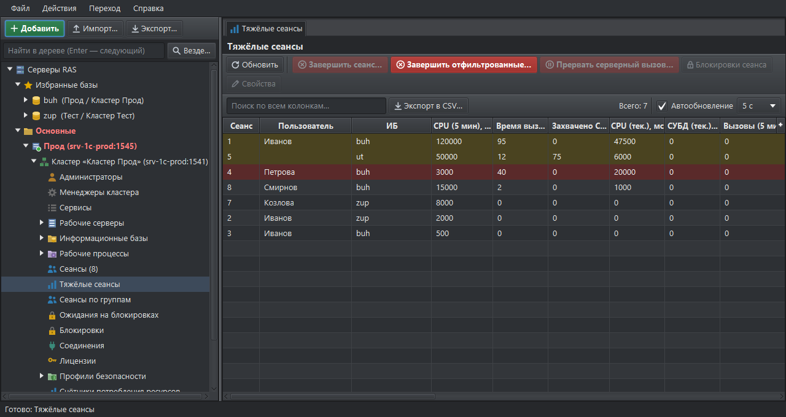 **Тёмная тема** |
| 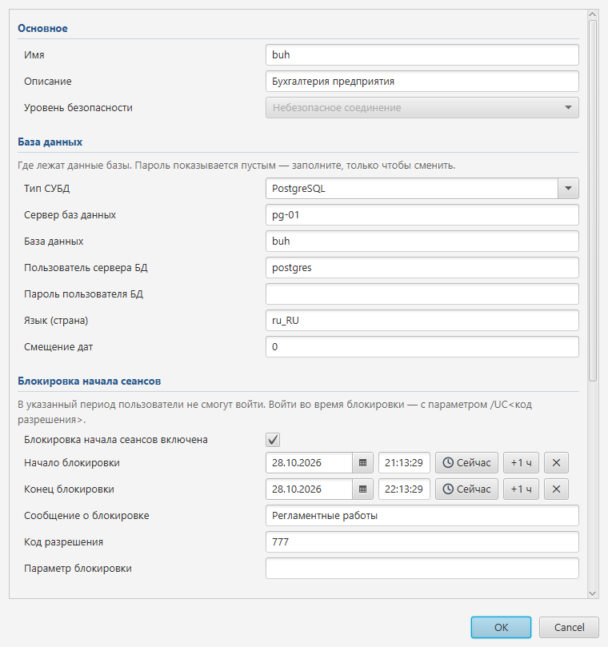 **Свойства базы**, разбитые по разделам | 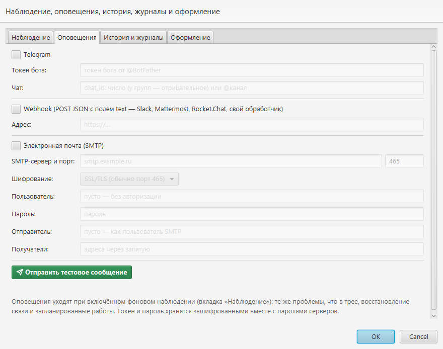 **Оповещения**: Telegram, webhook, почта |
| 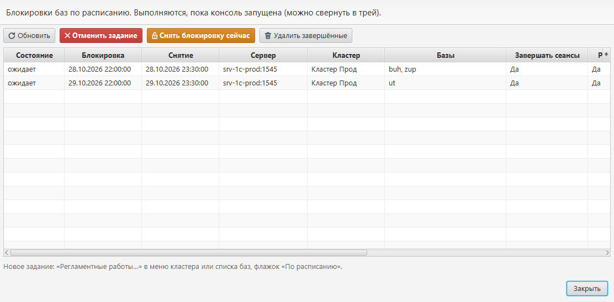 **Регламентные работы по расписанию** | 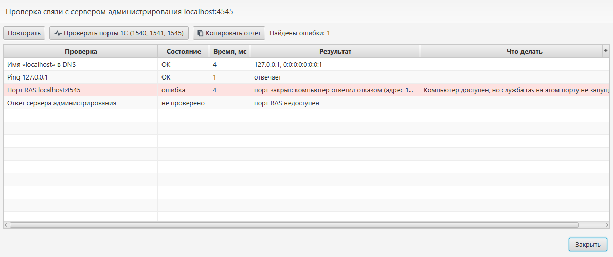 **Диагностика сети** с подсказками |
| 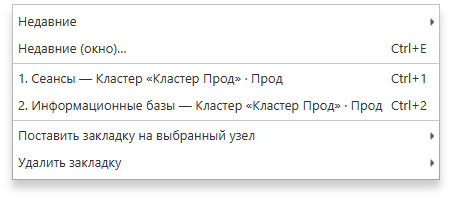 **Меню «Переход»**: закладки и недавние | 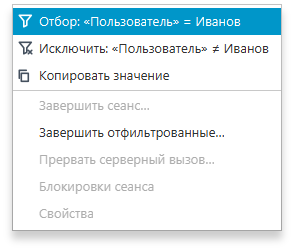 **Контекстное меню таблицы**: отбор и исключение по значению |

## Системные требования

### Для работы

| | Windows | Linux |
|---|---|---|
| ОС | Windows 10 / 11, Windows Server 2016+ (x64) | x64, графическое окружение (X11 / Wayland) |
| Java | **не нужна** — сборка `RasConsole.exe` содержит свою Java | Java **17 или новее с JavaFX**: [Axiom JDK Full](https://axiomjdk.ru/) или [Liberica JDK Full](https://bell-sw.com/pages/downloads/) (вариант *Full*) |
| Сохранение паролей | встроено (Windows DPAPI) | утилита `secret-tool` (пакет `libsecret-tools`) и связка ключей (GNOME Keyring, KWallet) |
| Библиотека 1С | для публичной сборки — архив с ИТС, указывается один раз при первом запуске (см. [«Первый запуск»](#первый-запуск-публичной-сборки)) | так же |

**На серверах 1С** должна работать служба `ras` той же версии, что и агент сервера (`ragent`), а её порт (по умолчанию **1545**) — быть открыт с компьютера администратора:

```
ras cluster --service --port=1545 localhost:1540
```

Обязателен только этот порт. Порты агента и кластера (1540, 1541, 1560–1591) нужны лишь для дополнительных функций — см. ниже.

**Необязательно, для отдельных функций:**
- Клиент платформы 1С на компьютере администратора. Нужен для «Открыть в 1С», «Конфигуратор» и для «Выключить» `rphost` через `rac`. Консоль сама выбирает версию, совпадающую с сервером.
- Доступ к портам кластера (1541 и диапазон рабочих процессов) — для запуска 1С с этого компьютера.

### Для сборки из исходников

- **JDK 17 или новее с JavaFX** — например, Axiom JDK Full, который ставится вместе с платформой 1С. Скрипты находят его сами. Проверено на 17 и 25.
- **Windows PowerShell 5.1** (есть в Windows 10/11).
- **Библиотека 1С для сервера администрирования** (`1cits_exe_java-api-8.3.11_java-api-8.3.11.zip`) — в репозиторий не входит, см. следующий раздел.

## Библиотека 1С для сервера администрирования

Консоль работает с кластером через официальную библиотеку **«1C:Enterprise 8 Administrative Service API»** версии 1.6.7 — «Программный Java-интерфейс для административного сервера» от фирмы «1С». Библиотека общается с `ras` по его бинарному протоколу — тому же, что использует `rac`.

- Описание и загрузка — на ИТС: **[Программный Java-интерфейс для административного сервера](https://its.1c.ru/db/content/metod8dev/src/admins/i8104985.htm)** (раздел «Методическая поддержка для разработчиков и администраторов»). Нужен вариант для версий **8.3.11 и старше**.
- Лицензия: © 1996–2017 ООО «1С-Софт». По условиям (`COPYRIGHT.txt` в дистрибутиве) пользоваться библиотекой могут только авторизованные пользователи «1С:Предприятия 8» в рамках лицензионного соглашения платформы. Поэтому **jar-файлы 1С в репозиторий не включены**: скачайте архив сами.
- Вместе с библиотекой поставляется [Netty 3.2.6](https://netty.io/) (Apache License 2.0).

В библиотеке есть ошибка: общий буфер кодека портит строки и UUID при одновременной работе нескольких соединений. Консоль её обходит (`ras/CodecFix.java`), подробности — в [руководстве](docs/MANUAL.md#ограничения).

## Сборка и запуск

1. Скачайте с ИТС архив Java API (см. выше) и положите `1cits_exe_java-api-8.3.11_java-api-8.3.11.zip` в корень репозитория.
2. Соберите программу:
   ```
   powershell -ExecutionPolicy Bypass -File build.ps1
   ```
   Скрипт извлечёт jar-файлы 1С в `lib\`, скомпилирует исходники и соберёт `dist\RasConsole\ras-console.jar`. Запуск: `dist\RasConsole\run.cmd`.
3. Отдельное приложение со встроенной Java и архивы для переноса. Сборок две:

   | Команда | Библиотека 1С | Для кого | Результат |
   |---|---|---|---|
   | `package.ps1` | **внутри** | для себя и своей организации | `dist\app\RasConsole\RasConsole.exe`, `dist\RasConsole-portable.zip`, `dist\RasConsole-linux.tar.gz` |
   | `package.ps1 -Public` | **нет** | для публикации (GitHub Releases и т. п.) | `dist\public\RasConsole-<версия>-windows.zip`, `dist\public\RasConsole-<версия>-linux.tar.gz` |

   ```
   powershell -ExecutionPolicy Bypass -File package.ps1 -Public
   ```
   В конце публичной сборки скрипт проверяет, что в неё не попал ни один файл 1С.

Публикуйте только сборку `-Public`. Сборка с библиотекой 1С — только для пользователей с правом на платформу «1С:Предприятие 8».

### Первый запуск публичной сборки

Публичная сборка при первом запуске просит архив библиотеки 1С: «Программный Java-интерфейс для административного сервера» с [ИТС](https://its.1c.ru/db/content/metod8dev/src/admins/i8104985.htm), вариант для 8.3.11 и старше. Это нужно сделать один раз:

- **Окно консоли.** Если архив лежит рядом с `RasConsole.exe` или в папке «Загрузки», консоль возьмёт его сама. Иначе откроется окно с кнопками «Открыть страницу ИТС» и «Выбрать архив…».
- **Командная строка:** `RasCli install-api <архив.zip>` (в Linux — `./rascli.sh install-api <архив.zip>`).

Консоль извлекает из архива только jar-файлы библиотеки — в `%APPDATA%\RasConsole\api` (в Linux — `~/.rasconsole/api`) — и дальше запускается сразу. Откуда загружена библиотека, видно в «Справка → О программе».

## Хранение логинов и паролей

Пароли сохраняются, только если в окне входа отметить **«Запомнить пароль»**, и только после того, как сервер их принял. Без флажка пароль живёт в памяти до закрытия программы.

Сохранённые пароли, а также токен Telegram-бота и пароль почты для оповещений хранятся **в зашифрованном виде** в профиле пользователя:

- **Windows** — стандартной защитой Windows (DPAPI). Расшифровать файл можно только под той же учётной записью Windows на том же компьютере. Скопированный на другой компьютер или открытый под другим пользователем, он бесполезен.
- **Linux** — шифрованием AES, ключ к которому лежит в связке ключей пользователя (GNOME Keyring, KWallet). Без утилиты `secret-tool` пароли не сохраняются.

Список серверов, настройки и журналы паролей не содержат.

Протокол RAS сам по себе не шифруется — так устроена платформа 1С. Открывайте порт RAS только для компьютеров администраторов.

## Документация

- **[Подробное руководство](docs/MANUAL.md)**: все функции, настройки, командная строка, версии платформы, ограничения, что проверено.
- Справка командной строки: `RasCli help`.

## Лицензия

Исходный код консоли распространяется по лицензии **MIT** — см. [LICENSE](LICENSE). Автор — [Magogui](https://github.com/Magogui).

Библиотека 1С для сервера администрирования под эту лицензию не подпадает. Она распространяется на условиях фирмы «1С» и в репозиторий не входит — см. раздел [«Библиотека 1С для сервера администрирования»](#библиотека-1с-для-сервера-администрирования).

## Структура репозитория

```
src/ru/rasconsole/      исходный код
  ras/                  соединение с RAS, обход ошибки кодека, отчёт, rac, поиск платформы
  config/               список серверов, пароли, избранное, наблюдение, журналы, запись .xlsx
  ui/                   главное окно, сводка, оповещения, настройки, диагностика сети, темы
  ui/cluster/           разделы кластера, регламентные работы, расписание, групповые операции
  ui/tree/, ui/table/   дерево, списки и таблицы
  tools/                Probe (проверка связи), IconGen (иконка), TarGz (архив для Linux)
icon/                   иконка приложения
docs/                   руководство и скриншоты
build.ps1, package.ps1  сборка (Windows PowerShell)
run.cmd, rascli.cmd     запуск из dist\RasConsole (Windows)
rasconsole.sh, rascli.sh, find-java.sh   запуск в Linux
```
